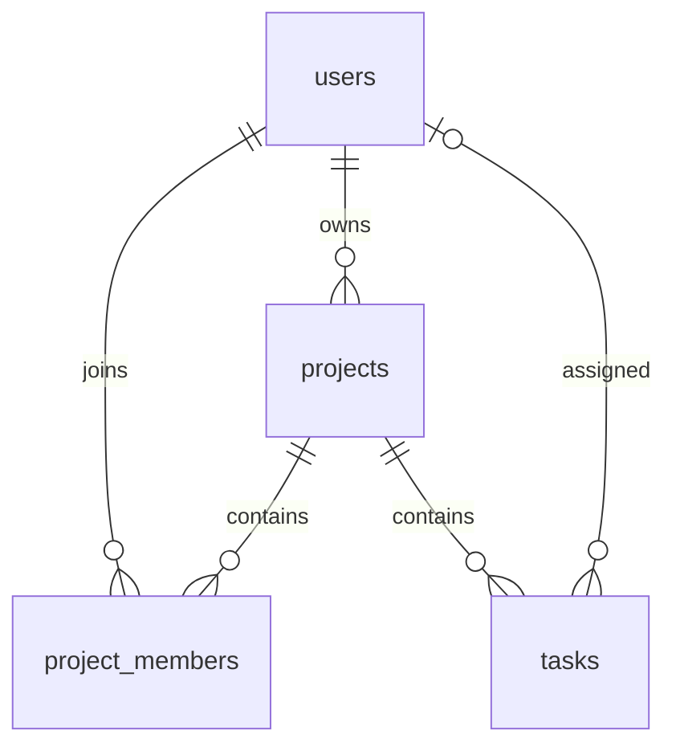

# 2. Projektēšana
## Arhitektūra
Pārlūks → Vue maršruts → Axios /api → Vite proxy izstrādē → Express Router → autentifikācija un CSRF → kontrolieris → serviss → SQL repozitorijs → MySQL.

Produkcijā Express apkalpo frontend/dist. Viena izcelsme atvieglo drošu sīkdatņu lietošanu. Pinia glabā pašreizējā lietotāja stāvokli un paziņojumus, bet biznesa dati saglabājas tikai MySQL.

## Datu attiecības

project_members satur arī īpašnieku; projekta izveide un īpašnieka dalība ir viena transakcija. UNIQUE(project_id,user_id) nepieļauj dubultu dalību. Dzēšot projektu, kaskādē dzēš dalību un uzdevumus. Lietotāja dzēšanu ar īpašumā esošu projektu ārējā atslēga ierobežo. Lietotāja dzēšanas API nav.

sessions tabulā glabā sid, serializētus sesijas datus, derīguma termiņu un user_id. user_id indekss ļauj anulēt visas lietotāja sesijas paroles maiņas laikā. Sesiju derīgums tiek pārbaudīts lasīšanā; serveris periodiski dzēš beigušās sesijas.

## Atļaujas
| Darbība | Īpašnieks | Dalībnieks | Svešs lietotājs |
|---|---|---|---|
| Lasīt projektu un uzdevumus | Jā | Jā | Nē |
| Izveidot/labot/dzēst uzdevumu | Jā | Jā | Nē |
| Labot/dzēst projektu | Jā | Nē | Nē |
| Pievienot/noņemt dalībnieku | Jā | Nē | Nē |

Neatļauta projekta lasīšana atgriež 404, neizpaužot tā esamību. Dalībnieka mēģinājums mainīt īpašnieka iestatījumus atgriež 403.

## Saskarnes struktūra
Kreisajā joslā: informācijas panelis, projekti, mani uzdevumi, komanda, iestatījumi. Galvenē: lapas nosaukums, tēmas pārslēgs, profils un izrakstīšanās. Projekta lapā: progress, Kanban, komanda un īpašnieka iestatījumi. TaskDialog atbalsta arī tastatūras un mobilā ekrāna statusa maiņu.

## Drošības plūsma
GET /auth/me izveido CSRF marķieri sesijā. Axios nosūta X-CSRF-Token visām turpmākām darbībām. Pieteikšanās un reģistrācija atjauno sesijas ID un marķieri. Paroles maiņa anulē citas sesijas. bcrypt izmanto 12 darba kārtas; ievade ierobežota līdz 72 UTF-8 baitiem. Atbildes neiekļauj password_hash.

